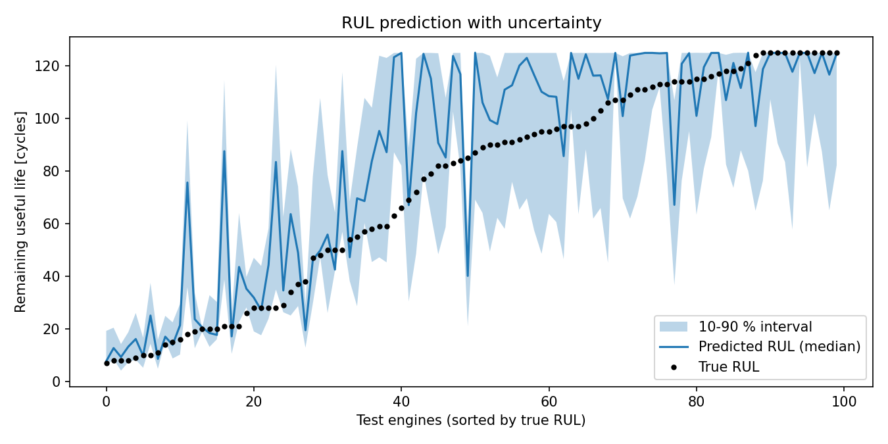
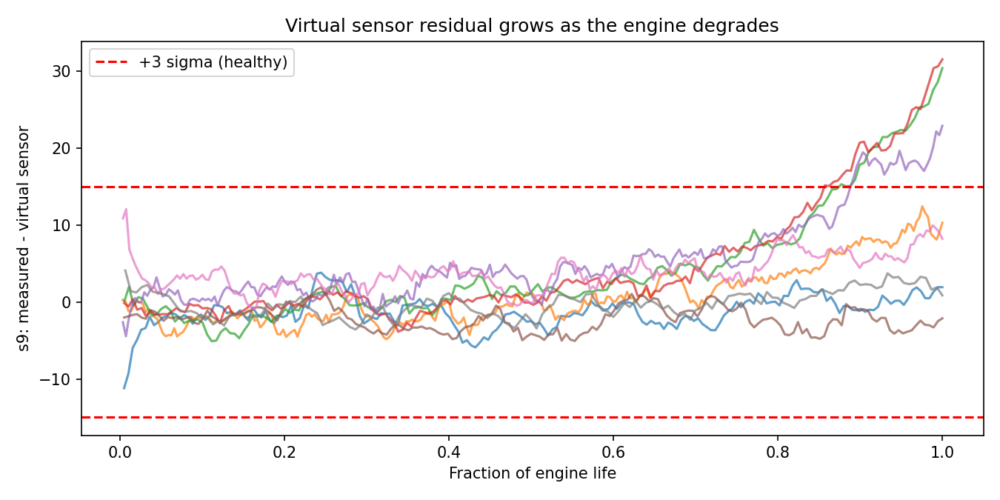

# Engine Health Analytics – RUL Prediction with Uncertainty & Virtual Sensor

A data science project on the **NASA C-MAPSS turbofan engine degradation dataset (FD001)**:
100 engines, 21 sensors, run until failure.

The goal is not just accuracy, but **trustworthy** predictions for safety-relevant decisions:
the model says how *sure* it is, and that claim is checked.

## What it does

**Part A – Remaining Useful Life (RUL) with uncertainty**
- Predicts how many cycles an engine has left, from its sensor history.
- Uses quantile gradient boosting to give a **10–90 % prediction interval**, not just a single number.
- Checks **interval coverage**: how often the true RUL actually falls inside the interval
  (ideal ≈ 80 %). If coverage is too low, the model is over-confident.

**Part B – Virtual sensor**
- Estimates one physical sensor (`s9`, core speed) from the other sensors, trained on *healthy* early-life data.
- The **residual** (measured − estimated) stays near zero while healthy and drifts as the engine degrades,
  so it works as a simple health / fault indicator.

**Validation done right**
- Cross-validation is split **per engine** (GroupKFold), never per row, so the model is always tested
  on engines it has never seen. This avoids data leakage, which would give falsely good results.

## Results (FD001)

| Metric | Value |
|---|---|
| Test RMSE (cycles) | 21.88 |
| Test MAE (cycles) | 15.37 |
| Cross-validation RMSE (cycles) | 20.03 |
| 10–90 % interval coverage on test set (target ≈ 0.80) | **0.79** |
| Mean interval width (cycles) | 42.7 |
| Virtual sensor MAE on healthy data | 3.99 |
| Virtual sensor residual: early life → end of life | −0.42 → 11.40 (healthy σ = 5.0) |

**Key findings**
- The prediction intervals are **well calibrated**: 79 % coverage against an 80 % target, so the model is not over-confident.
- Similar cross-validation and test errors (20.0 vs 21.9) confirm there is no data leakage.
- The virtual sensor residual grows to more than **2× its healthy spread** at end of life, showing degradation.
- The most important sensors for RUL were s2, s4, s3 and s11 (temperatures and pressures).




## How to run

```bash
pip install -r requirements.txt
# put train_FD001.txt, test_FD001.txt, RUL_FD001.txt in ./data
python engine_health.py --data data
# quick test without the dataset:
python engine_health.py --synthetic
```

## Data

NASA Prognostics Center of Excellence – C-MAPSS Turbofan Engine Degradation Simulation Data Set.
Also available on Kaggle (search “NASA CMAPSS” / “turbofan engine degradation”).

## Limitations
- The model **overestimates RUL for some mid-life engines**, so it should not be used alone for maintenance decisions.
- FD001 has one operating condition and one fault mode; real engines are more complex.

## Next steps
- Test on FD002–FD004 (multiple operating conditions and fault modes).
- Try sequence models (LSTM / 1D-CNN) on the sensor history.
- Use conformal prediction to guarantee interval coverage.

*Author: Mohamed Yosif Abdo – M.Sc. Electrical Engineering (Automation & Robot Technology), DTU*